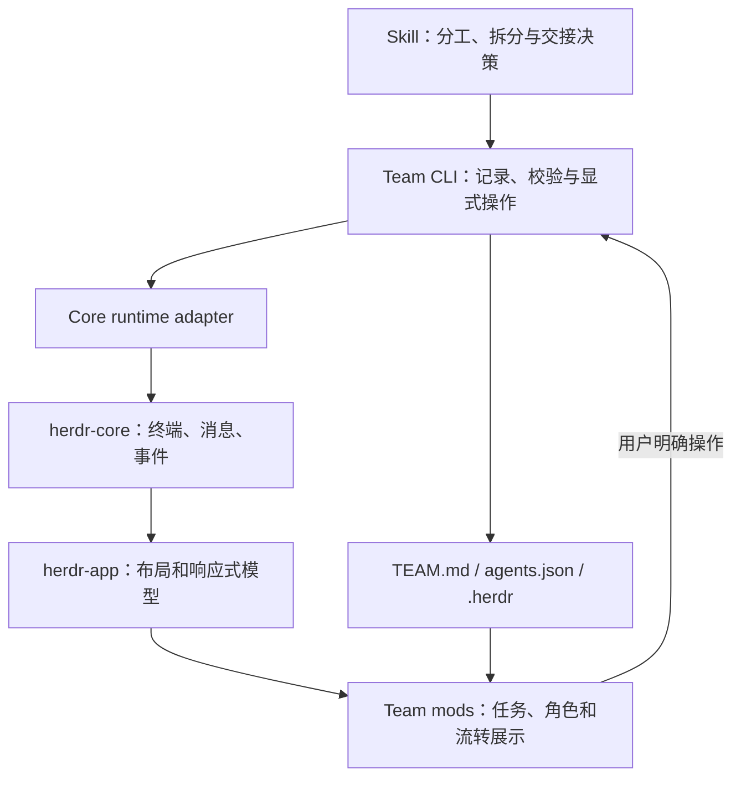

# 桌面版迁移研究

结论：适合做独立的 **layout＋mod 包**，运行层接 `herdr-core`，不需要自建桌面应用。旧插件中的任务规则可复用，旧 Herdr 运行适配不能直接复用。

## 核对依据

2026-11-18 本机：`herdr-app --version` 为 `0.1.16`，`hc --version` 为 `0.1.21`。读取了本机 app home 的 `AGENTS.md`、`herdr.d.ts`、`gpui-kit.d.ts`，以及两个 CLI 的帮助和内置 Skill。

另行核对上游源码：

- [herdr-app](https://github.com/herdrdev/herdr-app/tree/4deb605f0b3d25d409c80cff9082d5c19a043ea8)，研究快照 `4deb605`。
- [herdr-core](https://github.com/herdrdev/herdr-core/tree/c7517808d64f06609e4ecf0db1757005373cc3a3)，研究快照 `c751780`。

上游 master 与本机版本分开记录；实现以本机生成的类型为准。

## 能力和分工

| 需求 | 原生能力 | 本项目要做的事 |
| --- | --- | --- |
| 整体布局 | JSON 树，row/column/stack/block，可调整大小 | 单独的 `team` layout，引用内置终端和导航 |
| 团队面板 | JS mod → GPUI 原生元素 | 任务、角色、交接路径的展示及明确操作入口 |
| 动画 | 原生 frames、loop、transition | 活跃状态使用原生动画，无 JS 高频重绘 |
| agent 列表 | `agents()`、`terminals()`、`panes()` 响应式数据 | 用项目、机器、space 和任务标签筛选，不自己轮询 |
| 终端运行与消息 | `hc run/send/wait`、API 及事件订阅 | 适配既有 delivery，保留去重和不确定提交处理 |
| 任务文件变化 | 本地 `watchFolder()`；远程读取走所选机器 | 监听绑定项目，不每次读取所有项目 |
| worktree | 内置 worktree mod 负责桌面交互；Git 管实际检出 | 自动任务 worktree 仍需显式适配，不把对话框当稳定业务 API |

来源：[桌面扩展指南](https://github.com/herdrdev/herdr-app/blob/4deb605f0b3d25d409c80cff9082d5c19a043ea8/defaults/AGENTS.md)、[Core API](https://github.com/herdrdev/herdr-core/blob/c7517808d64f06609e4ecf0db1757005373cc3a3/schema/README.md)。

## 与旧 Herdr 的关键差异

1. **运行状态来源改变。** Core 根据程序的 OSC 7501 上报保存状态，不解析屏幕识别品牌。无报告应保留 unknown；不能沿用旧的 `pane report-agent`。无原生上报的 agent 需要经过验证的状态适配，不能通过修改 labels 伪装成状态。
2. **布局归桌面版。** Core 管 terminal；space/tab/pane 属于 app 的布局文档，并同步在机器的 Core 中。终端可用 `herdr.space`、`herdr.tab` 标签进入已有界面。旧 `w...:p...` ID 和新 `t...` address 不能互换。
3. **标签只保存归属事实。** 推荐 `team.project`、`team.role`、`team.task`、`team.session`、`team.preset`；project 是机器上的规范化主检出。复用会话前还要验证机器、space 与实际 cwd，不能只匹配 repo 名。
4. **Core 自带发送门控，业务幂等仍需 CLI。** `hc send --if idle` 会校验状态并顾及用户草稿，但不是任务的事务队列。超时、连接中断或未观察到活动，都不能直接重发同一 delivery。必须保留 claim、交棒回执及不确定状态核查。
5. **保活不等于恢复对话。** 丢失的 kept terminal 恢复为 shell，并不会重跑原命令。恢复 agent 仍需记录已确认且实际可恢复的会话，不因为 terminal 地址没变就认为原 agent 还活着。
6. **Codex 保持 `--no-daemon`。** Core 内置手册明确要求这样启动，否则工具执行会跑到 Core 终端之外。

任务 worktree 可以有自己的 space；额外使用本插件约定的 `team.owner_space` 指向协调 space，保留 `herdr.space` 作为实际展示位置。同项目另一个协调 space 不共享这一归属。`team.*` 是插件自己的标签约定，Core 不替插件验证或解释它们；运行适配层需要负责校验。

证据：[Core 状态实现](https://github.com/herdrdev/herdr-core/blob/c7517808d64f06609e4ecf0db1757005373cc3a3/crates/herdr-core/src/status.rs)、[终端记录](https://github.com/herdrdev/herdr-core/blob/c7517808d64f06609e4ecf0db1757005373cc3a3/crates/herdr-core/src/terminals.rs)、[原生模板及就绪说明](https://github.com/herdrdev/herdr-core/blob/c7517808d64f06609e4ecf0db1757005373cc3a3/docs/templates.md)。Codex 要求另由本机 `hc --skill` 确认。

## 推荐架构

不复制整份 herdr-team 仓库。先让两个前端复用同一套任务记录与 JSON 输入输出；只有完成运行接口梳理后，才考虑从旧仓库提取可共享的业务模块。新 mod 不导入兄弟仓库的绝对源码路径。

不把桌面窗口变成唯一调度进程。关闭窗口后 Core 中的程序仍在，但 UI mod 的异步循环会停；后续队列需要明确的 Core 托管 coordinator 或用户显式 dispatch，而不是声称 Core 已自带业务队列。本阶段未新增 coordinator。

## 当前实现的边界

- `team` layout 和原生 `team-console` mod 已建立，默认 Sample；真实 Core 数据与样例不会混用。
- 只读 tasks/roles 通过现有 `herdr-team` 的 JSON 接口读取；不重新实现 YAML 和任务校验。
- live 必须固定 root、machine、space。只展示对应标签的终端；没有匹配状态时保留 unknown。
- 本地文件监听、Core 响应式数据和手动刷新已接入代码；**真实桌面团队的启动、投递、审批、恢复和清理还没有实现或端到端验收**。
- 原生 `check` 只覆盖初次执行及渲染，不能替代安装后的视觉、切换、远程、监控和异步状态验收。

## 资源与性能约束

mods 没有 DOM、Node API 或普通 `setTimeout`；使用宿主模块。绘制交给 GPUI，动画交给原生组件。隐藏的 mod 仍可能存活，因此不靠短周期 timer 保持刷新。

本地 watcher 要取消；Linux 对 Git 忽略目录的处理、监控数量和目录上限都可能影响监听。初始版失败时明确提示 Refresh；远程只手动刷新，尚未承诺远程推送。

后续 Core API 客户端应处理 snapshot、event 和 missed 后的重建，不假设事件永不丢失。Skill/CLI 业务状态仍以持久记录为准。
